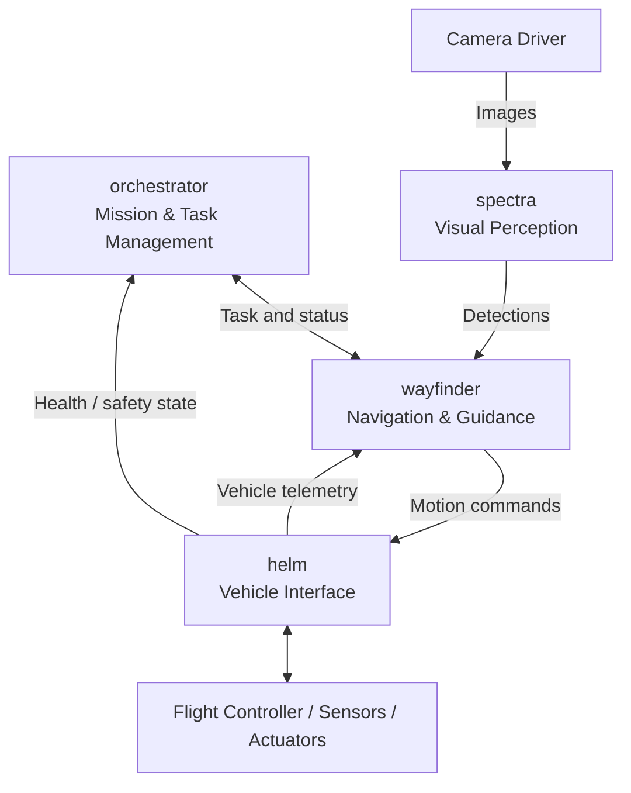
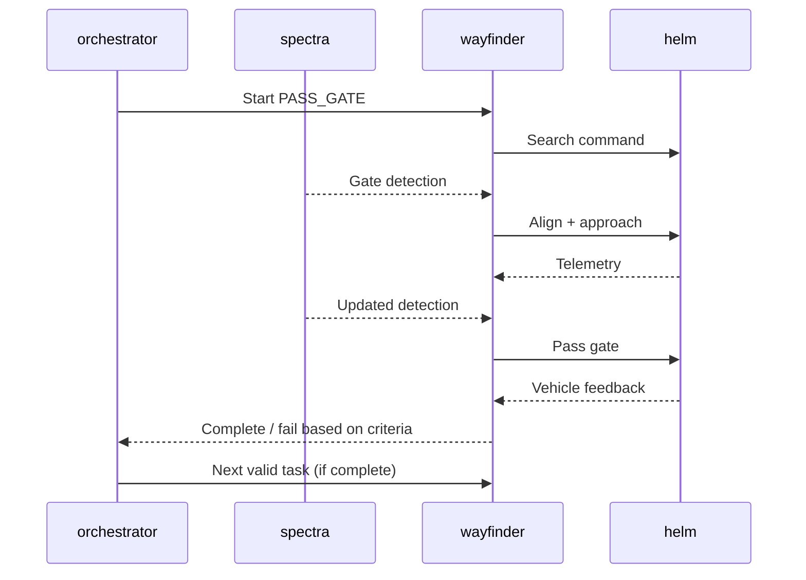

# Product Requirements Document (PRD)
# Aterkia — AUV Autonomy Stack

| Metadata | Detail |
| --- | --- |
| Status | Draft v0.1 — baseline pengembangan |
| Tanggal | 22 Oktober 2026 |
| Proyek | Aterkia |
| Platform | ROS 2, C++, Python |
| Package inti | `orchestrator`, `spectra`, `wayfinder`, `helm`, `bootstrap` |
| Target kompetisi | Singapore Autonomous Underwater Vehicle Challenge (SAUVC) 2027 |

> **Status aturan:** Daftar misi dan dependensi kompetisi di bawah menggunakan rulebook SAUVC 2026 sebagai referensi kerja. Implementasi harus ditinjau ulang saat rulebook SAUVC 2027 diterbitkan. Perangkat keras, distribusi ROS 2, dan batas performa belum diputuskan.

## 1. Ringkasan Produk

Aterkia adalah software stack autonomous untuk AUV yang menjalankan misi kompetisi melalui ROS 2. Sistem menerima data kamera dan sensor, mengenali objek di lingkungan bawah air, menentukan manuver untuk mencapai tujuan, mengirimkan perintah ke flight controller, serta mengoordinasikan urutan tugas dari awal hingga akhir.

Arsitektur awal terdiri atas lima package dengan tanggung jawab terpisah. Implementasi diprioritaskan untuk menghasilkan **satu alur misi yang benar-benar berfungsi** sebelum memperluas kemampuan ke seluruh tugas kompetisi.

### 1.1 Problem Statement

Pengembangan AUV melibatkan beberapa domain (misi, persepsi, navigasi, kendali kendaraan) yang saling membutuhkan data. Tanpa pembagian tanggung jawab, perubahan algoritma computer vision dapat merusak logika misi, integrasi hardware menjadi sulit diuji, dan debugging di kolam memakan waktu.

Sistem dibutuhkan agar modul dapat diuji secara terpisah, dipadukan secara bertahap, serta dikonfigurasi tanpa mengubah kode untuk setiap percobaan.

### 1.2 Tujuan Produk

1. Mampu menjalankan rangkaian tugas AUV secara autonomous menggunakan ROS 2.
2. Menyediakan modul persepsi visual, navigasi, manajemen misi, dan interface kendaraan yang terpisah.
3. Memungkinkan pengujian tanpa hardware penuh melalui input rekaman/simulasi dan mock vehicle.
4. Memiliki mekanisme timeout, abort, dan penghentian perintah gerak yang aman.
5. Menyediakan fondasi untuk adaptasi perubahan rulebook SAUVC 2027.

### 1.3 Indikator Keberhasilan Awal

- Seluruh package dapat dibangun dan dijalankan bersama melalui `bootstrap`.
- Satu tugas gate dapat dieksekusi end-to-end: perintah misi → deteksi → gerakan → feedback → status tugas.
- Gangguan data kamera/telemetry, timeout, atau abort tidak menyebabkan perintah gerak berjalan tanpa batas.
- Urutan tugas dan parameter dasar dapat diubah melalui YAML tanpa kompilasi ulang.
- Hasil pengujian dapat ditelusuri dari log dan rekaman data ROS 2.

## 2. Scope dan Asumsi

### 2.1 In Scope — Versi Awal

- Manajemen urutan tugas dan transisi status.
- Deteksi objek visual relevan dari kamera.
- Perilaku gerak dasar: search, align, approach, pass, hold, dan turn.
- Pengiriman setpoint/perintah gerak ke sistem kendali kendaraan.
- Pembacaan telemetry penting (minimal kedalaman, orientasi/heading, status koneksi).
- Konfigurasi dan peluncuran node melalui satu entry point.
- Failsafe software tingkat aplikasi, logging, serta pengujian integrasi.

### 2.2 Out of Scope — Versi Awal

- SLAM, peta 3D, global path planning, atau sensor fusion kompleks.
- Behavior tree framework dan microservice orchestration.
- Dashboard GUI penuh, cloud backend, atau telemetri internet.
- Implementasi ulang PID stabilisasi jika autopilot telah menanganinya.
- Protokol MAVLink buatan sendiri jika MAVROS/integrasi yang tersedia sudah mencukupi.
- Package ROS tambahan hanya untuk pengelompokan kosmetik.

### 2.3 Asumsi dan Ketergantungan

- AUV memiliki companion computer yang menjalankan ROS 2 dan flight controller atau kontroler kendaraan.
- Kamera serta sumber telemetry tersedia melalui driver/bridge yang sesuai.
- Mekanisme payload (drop/pickup) hanya diaktifkan setelah hardware dan cara kendalinya ditetapkan.
- Autopilot boleh menangani stabilisasi tingkat rendah, sedangkan `wayfinder` menangani guidance.
- Uji underwater dilakukan dengan prosedur keselamatan dan physical kill switch yang independen dari software.

## 3. Konteks Kompetisi

Berdasarkan rulebook **SAUVC 2026** yang dijadikan referensi sementara:

| Tahap / misi | Kemampuan yang relevan |
| --- | --- |
| Qualification | Lewati gate, lakukan U-turn, lewati gate kembali; tetap terendam dan hindari kontak |
| Navigation | Cari dan lewati gate; hindari rintangan atau flare terlarang |
| Target Acquisition | Temukan drum, identifikasi target, posisikan kendaraan, lepaskan bola |
| Target Reacquisition | Kembali melalui gate sesuai prasyarat, temukan lagi target, ambil bola |
| Communication & Localization | Terima urutan flare, identifikasi warna, datangi target sesuai urutan |

**Ketentuan alur yang perlu dijaga:** Pada acuan 2026, Navigation wajib dilakukan sebelum misi final lainnya; Target Reacquisition memiliki prasyarat Target Acquisition dan melewati gate lagi. Jadi, urutan misi tidak boleh diperlakukan sebagai daftar bebas tanpa validasi prasyarat.

Referensi: [SAUVC Rulebook](https://sauvc.org/rulebook/) dan [repositori rulebook resmi](https://github.com/sauvc/rulebook). Semua detail misi 2027 berstatus *to be confirmed*.

## 4. Pengguna dan Skenario Operasional

**Pengguna utama:** anggota tim software/robotika yang mengembangkan, menguji, dan mengoperasikan AUV.

**Skenario:**
- **Development / replay:** developer memutar rekaman kamera dan telemetry untuk memverifikasi persepsi dan gerakan tanpa thruster aktif.
- **Integration / simulation:** seluruh alur berjalan terhadap mock vehicle atau simulator dengan command-output terpantau.
- **Field test:** operator melakukan preflight check, mengaktifkan misi, memantau status, dan dapat melakukan abort sesuai prosedur.
- **Competition:** setelah start yang sah, AUV mengeksekusi rencana autonomous sesuai aturan yang berlaku.

## 5. Arsitektur Sistem

### 5.1 Package dan Kepemilikan Tanggung Jawab

| Package | Bahasa | Tanggung jawab utama | Batasan |
| --- | --- | --- | --- |
| `orchestrator` | C++ | Urutan misi, task lifecycle, prasyarat, timeout, retry, abort | Tidak mengolah gambar atau menghasilkan PWM |
| `spectra` | Python | Pemrosesan gambar, object detection, confidence, posisi target dalam frame kamera | Tidak menentukan urutan misi atau mengontrol thruster |
| `wayfinder` | C++ | Guidance dan perilaku gerak (search/align/approach/pass/hold/turn) berdasarkan target dan telemetry | Tidak mengakses hardware secara langsung |
| `helm` | C++ | Bridge perintah kendaraan, telemetry, aktuator, koneksi, command timeout | Tidak menentukan target misi |
| `bootstrap` | ROS 2 launch Python + YAML | Launch, parameter, mode simulasi/hardware, wiring node | Tidak membutuhkan ROS node bisnis sendiri |

### 5.2 Diagram Komponen

`bootstrap` meluncurkan node dan memuat parameter; ia tidak berada pada jalur data runtime.

### 5.3 Batas Antarkomponen

- `orchestrator` memutuskan **apa yang dikerjakan**.
- `spectra` menyediakan **apa yang terlihat**.
- `wayfinder` menentukan **bagaimana bergerak menuju tujuan**.
- `helm` melaksanakan **perintah kendaraan dan menyediakan feedback**.
- `bootstrap` menentukan **bagaimana sistem diinisialisasi**.

Satu tugas hanya boleh memiliki satu pemilik eksekusi aktif; hindari dua modul yang secara bersamaan menerbitkan perintah gerak ke aktuator yang sama.

## 6. Kebutuhan Fungsional

Prioritas: **P0** wajib untuk MVP, **P1** setelah MVP stabil, **P2** pengembangan lanjutan.

| ID | Prioritas | Kebutuhan | Acceptance Criteria |
| --- | --- | --- | --- |
| FR-01 | P0 | `bootstrap` memuat konfigurasi dan menjalankan komponen inti | Satu `ros2 launch` dapat menjalankan stack uji tanpa start node satu per satu |
| FR-02 | P0 | `orchestrator` membaca urutan tugas dari konfigurasi | Urutan dapat diubah lewat YAML dan terbaca saat startup |
| FR-03 | P0 | `orchestrator` mengelola lifecycle tugas | Status IDLE/RUNNING/COMPLETED/FAILED/ABORTED tercatat dengan jelas |
| FR-04 | P0 | `spectra` mempublikasikan deteksi gate | Posisi, class, confidence, dan timestamp hasil deteksi dapat dikonsumsi `wayfinder` |
| FR-05 | P0 | `wayfinder` menjalankan search, align, approach, pass, hold dan turn sederhana | Input task dan data sensor menghasilkan command serta feedback sesuai kondisi |
| FR-06 | P0 | `helm` meneruskan perintah ke autopilot atau mock adapter | Perintah diterjemahkan dengan benar, termasuk konvensi koordinat dan satuan |
| FR-07 | P0 | `helm` menerbitkan kondisi kendaraan | Depth, heading, dan status koneksi tersedia untuk komponen konsumen |
| FR-08 | P0 | Sistem mendukung abort, timeout, dan command watchdog | Ketika abort atau data kendali tidak valid, output gerak masuk kondisi aman terdefinisi |
| FR-09 | P0 | Status tugas ditentukan dari kriteria keberhasilan | Timeout atau durasi gerak saja tidak otomatis dianggap tugas berhasil |
| FR-10 | P0 | Pengujian dapat dilakukan tanpa thruster nyata | Mock/simulation adapter menerima command dan mencatat output |
| FR-11 | P1 | `spectra` mengenali drum dan flare | Deteksi dan label target dapat dibaca navigasi dengan frame/timestamp yang jelas |
| FR-12 | P1 | Orchestrator memvalidasi dependensi misi | Tugas yang prasyaratnya belum terpenuhi ditolak atau dilewati menurut policy |
| FR-13 | P1 | Kontrol payload ball-drop dan ball-pickup | Aktuator hanya dijalankan lewat `helm` ketika mendapat perintah sah |
| FR-14 | P1 | Mission plan dapat mencakup tugas final SAUVC | Konfigurasi memuat misi final sesuai rulebook terbaru |
| FR-15 | P2 | Perluasan localization/sensor fusion jika diperlukan | Package baru hanya dibuat jika kebutuhan dan interface terukur sudah ada |

### 6.1 Lifecycle Misi

Status minimal:

- `IDLE`: belum ada tugas berjalan.
- `RUNNING`: suatu tugas sedang dikerjakan.
- `COMPLETED`: kriteria keberhasilan terpenuhi.
- `FAILED`: kriteria gagal/timeout tercapai, retry atau abort dapat dipilih.
- `ABORTED`: eksekusi dihentikan dan command gerak harus masuk kondisi aman.

Orchestrator hanya memulai tugas berikutnya setelah hasil tugas sebelumnya diterima dan prasyaratnya terpenuhi. Pada kondisi abort, sistem tidak melakukan auto-resume tanpa perintah baru dari operator.

### 6.2 Contoh Alur: Gate Navigation

**Catatan validasi:** melewati gate memerlukan indikator keberhasilan yang dapat diuji (misalnya pengamatan sebelum/sesudah, estimasi perpindahan, atau sensor relevan). Keberhasilan tidak boleh hanya ditentukan dari timer tanpa bukti.

## 7. Kontrak ROS 2 — Draft MVP

Kontrak berikut adalah **rancangan internal**, bukan nama topik atau message bawaan MAVROS. Adaptasi terakhir mengikuti flight controller dan sensor yang dipilih.

| Topic | Producer | Consumer | Tipe / payload awal |
| --- | --- | --- | --- |
| `/camera/image_raw` | Driver kamera | `spectra` | `sensor_msgs/msg/Image` |
| `/perception/detections` | `spectra` | `wayfinder` | `vision_msgs/msg/Detection2DArray` |
| `/mission/task` | `orchestrator` | `wayfinder` | `std_msgs/msg/String` (prototipe) |
| `/navigation/status` | `wayfinder` | `orchestrator` | `std_msgs/msg/String` (prototipe) |
| `/cmd_vel` | `wayfinder` | `helm` | `geometry_msgs/msg/Twist` |
| `/vehicle/depth` | `helm` | `wayfinder` | `std_msgs/msg/Float64` (meter) |
| `/vehicle/heading` | `helm` | `wayfinder` | `std_msgs/msg/Float64` (radian; referensi disepakati) |
| `/vehicle/health` | `helm` | `orchestrator` | `diagnostic_msgs/msg/DiagnosticArray` (opsional saat MVP) |

**Konvensi penting:**
- Hasil deteksi kamera harus menyertakan timestamp dan frame yang sesuai, dengan definisi class yang konsisten.
- `helm` wajib mengonversi frame/satuan ROS 2 ke konvensi flight controller yang digunakan; jangan menyamakan NED dan ENU.
- `/cmd_vel` adalah abstraksi awal. Apabila flight controller membutuhkan depth/heading setpoint atau mode kontrol khusus, implementasi adapter dan kontrak akhir ditetapkan setelah uji integrasi.
- Dua topic `String` dipakai hanya untuk pembuktian alur sederhana dengan satu task aktif. Sebelum menjalankan beberapa task/retry yang memerlukan identitas eksekusi, gunakan **ROS 2 Action** dengan goal ID, feedback, cancel, dan result yang eksplisit. Tambahkan package `interfaces` hanya ketika custom message/action benar-benar diperlukan.
- QoS kamera/telemetry serta timeout data ditentukan dan diuji secara eksplisit; jangan menggunakan pesan sensor lama sebagai kondisi terkini.

## 8. Kebutuhan Nonfungsional dan Keselamatan

| Area | Persyaratan |
| --- | --- |
| Maintainability | Satu tanggung jawab per package, parameter tidak di-hardcode, nama interface konsisten |
| Build & startup | Semua package dapat dibangun via `colcon build`; start stack dari `bootstrap` |
| Observability | Setiap transisi misi, abort, hilang koneksi, dan error penting memiliki log dengan waktu |
| Testability | Vision dapat diuji dari data rekaman; navigasi dan helm dapat diuji menggunakan mock |
| Performance | Target latensi, FPS, dan frekuensi kontrol ditetapkan setelah benchmark hardware, bukan angka asumsi |
| Resilience | Jika telemetry/kamera invalid atau stale, perilaku aman didefinisikan dan tugas tidak lanjut buta |
| Safety | Abort software, watchdog command, manual override, dan physical kill switch independen |
| Operational readiness | Default saat startup adalah kondisi tidak armed/tidak bergerak sampai preflight dan otorisasi selesai |

Keselamatan hardware menjadi syarat terpisah. Software tidak dapat menggantikan physical kill switch, prosedur uji kolam, maupun failsafe pada flight controller.

## 9. Struktur Repository

Lokasi root: `Road-to-SAUVC-2027/`.

| Lokasi | Isi |
| --- | --- |
| `PRD.md` | Dokumen kebutuhan produk ini |
| `src/orchestrator/` | ROS 2 package manajemen misi (C++) |
| `src/spectra/` | ROS 2 package vision (Python) |
| `src/wayfinder/` | ROS 2 package navigasi (C++) |
| `src/helm/` | ROS 2 package interface kendaraan (C++) |
| `src/bootstrap/launch/` | Launch file sistem |
| `src/bootstrap/config/` | Parameter YAML: mission, perception, navigation, vehicle |
| `tests/` | Pengujian sistem lintas package (opsional ketika integrasi dimulai) |
| `README.md` | Setup, build, launch, dan panduan kontributor (dibuat saat implementasi) |

Gunakan `ament_cmake` untuk package C++ dan `bootstrap` (install launch/config), serta `ament_python` untuk `spectra`. Package baru tidak ditambahkan tanpa kebutuhan teknis yang konkret.

## 10. Strategi Pengembangan dan Milestone

| Milestone | Deliverable | Definition of Done |
| --- | --- | --- |
| M0 — Foundation | Workspace dan lima package, parameter, launch | Build bersih dan node inti dapat di-start |
| M1 — Vehicle Loop | `helm` adapter/mock, telemetry, command watchdog, kontrol dasar `wayfinder` | Perintah dan feedback terverifikasi tanpa hardware maupun di bench test |
| M2 — Visual Gate | `spectra` gate detector dan integrasi ke `wayfinder` | Gate terdeteksi dari data uji; search-align-approach dapat dieksekusi |
| M3 — Qualification MVP | `orchestrator` mengelola pass gate → U-turn → return pass gate | Alur end-to-end lulus pengujian terkontrol, abort/failure diuji |
| M4 — Finals Expansion | Drum, flare, ball-drop/pickup sesuai hardware dan aturan | Masing-masing tugas memiliki skenario uji dan acceptance criteria spesifik |

Milestone di atas **tidak mengasumsikan tanggal penyelesaian** atau kesiapan hardware yang belum dikonfirmasi. Mulai M1–M3 sebelum memperluas M4.

## 11. Acceptance Test MVP

- [ ] `colcon build` berhasil tanpa error untuk semua package proyek.
- [ ] `ros2 launch bootstrap auv.launch.py` menjalankan komponen yang dibutuhkan dalam mode uji.
- [ ] Deteksi gate dapat dihasilkan dari rekaman gambar dan diterima `wayfinder`.
- [ ] Satu mission command menghasilkan urutan search → align → approach → pass dengan feedback.
- [ ] `orchestrator` memulai tugas selanjutnya **hanya** ketika tugas sebelumnya dinyatakan selesai.
- [ ] Timeout tugas ditandai `FAILED`; tidak terjadi success palsu.
- [ ] Abort selama gerak menghentikan/menetralkan perintah melalui jalur keselamatan yang sudah ditetapkan.
- [ ] Hilangnya input telemetry atau command watchdog timeout diuji dengan mock, menghasilkan kondisi aman.
- [ ] Konfigurasi urutan tugas dapat diganti tanpa mengubah source code.
- [ ] Minimal satu sesi replay/simulasi dan satu uji hardware terkontrol terdokumentasi dengan log.

Pengujian kolam harus memakai standar kelulusan kuantitatif (misalnya tingkat keberhasilan dari beberapa percobaan) **setelah** kondisi arena, kemampuan sensor, dan toleransi kegagalan disepakati.

## 12. Risiko dan Mitigasi

| Risiko | Dampak | Mitigasi |
| --- | --- | --- |
| Rulebook SAUVC 2027 berubah | Tugas atau prasyarat tidak sesuai | Pisahkan urutan misi dalam konfigurasi; revisi requirement setelah rulebook terbit |
| Gambar underwater keruh/gelap | Salah deteksi atau target hilang | Uji rekaman kolam; confidence threshold dan perilaku search/retry |
| Telemetry tidak stabil | Perintah gerak tidak akurat | Validasi timestamp, timeout, health checking, abort aman |
| Konvensi frame/satuan salah | Gerak berlawanan arah | Tetapkan frame, satuan, sign, dan uji adapter sebelum gerak nyata |
| Autopilot dan navigasi berebut kontrol | Instabilitas | `wayfinder` mengirim guidance, stabilisasi low-level ditangani satu pengendali |
| Status tugas ambigu | Transisi misi salah | Satu task aktif pada MVP; naikkan ke ROS 2 Action saat butuh goal/result terstruktur |
| Integrasi payload belum siap | Misi target tertunda | Isolasi payload di `helm`, mulai dari simulasi/mock actuator |

## 13. Keputusan yang Masih Terbuka

1. Distribusi ROS 2 yang dipakai dan OS companion computer.
2. Jenis flight controller, firmware, dan antarmuka kendali (MAVROS atau adapter lain).
3. Konfigurasi kamera, IMU, depth sensor, sensor tambahan, dan frame koordinat.
4. Mekanisme ball-drop, ball-pickup, serta driver aktuatornya.
5. Kriteria operasional pembuktian gate sudah dilewati.
6. Definisi handling kegagalan: retry, skip, return, atau abort untuk tiap misi.
7. Urutan dan prasyarat misi berdasarkan **rulebook SAUVC 2027 final**.
8. Target uji kuantitatif (akurasi deteksi, latensi kontrol, success rate) berdasarkan hasil benchmark.

Keputusan hardware yang sudah dikonfirmasi operator: Pixhawk dengan ArduSub,
sensor depth, dan delapan thruster dengan susunan Vectored-6DoF sesuai gambar
operator. Stabilisasi dan pencampuran output motor menggunakan kemampuan ArduSub.
Pemetaan gambar dicatat di `docs/hardware-and-finals.md`; wiring dan arah motor
tetap memerlukan verifikasi fisik. Arming/disarming dapat diimplementasikan serta
diuji terpisah dari kendali gerak. Mekanisme payload dan sensor tambahan belum ada.

## 14. Prinsip Pengambilan Keputusan Teknis

- Pilih solusi **paling sederhana yang bisa diuji** untuk kebutuhan saat ini.
- Jangan menambah package untuk setiap misi: pada awalnya misi dapat direpresentasikan sebagai class/state di `orchestrator`.
- Jangan menambah ROS node jika sebuah fungsi cukup sebagai class biasa.
- Jangan menerapkan navigation stack yang kompleks sebelum guidance berbasis kamera dan telemetry dasar stabil.
- Driver dan stabilisasi yang sudah berfungsi pada autopilot sebaiknya digunakan kembali.
- Setiap modul mempunyai input, output, tanggung jawab, dan acceptance test yang jelas.

---

**Status dokumen:** PRD ini adalah baseline arsitektur dan cakupan MVP. Perubahan penting (khususnya hardware, interface ROS 2, dan rulebook 2027) harus dicatat di revisi PRD berikutnya.
