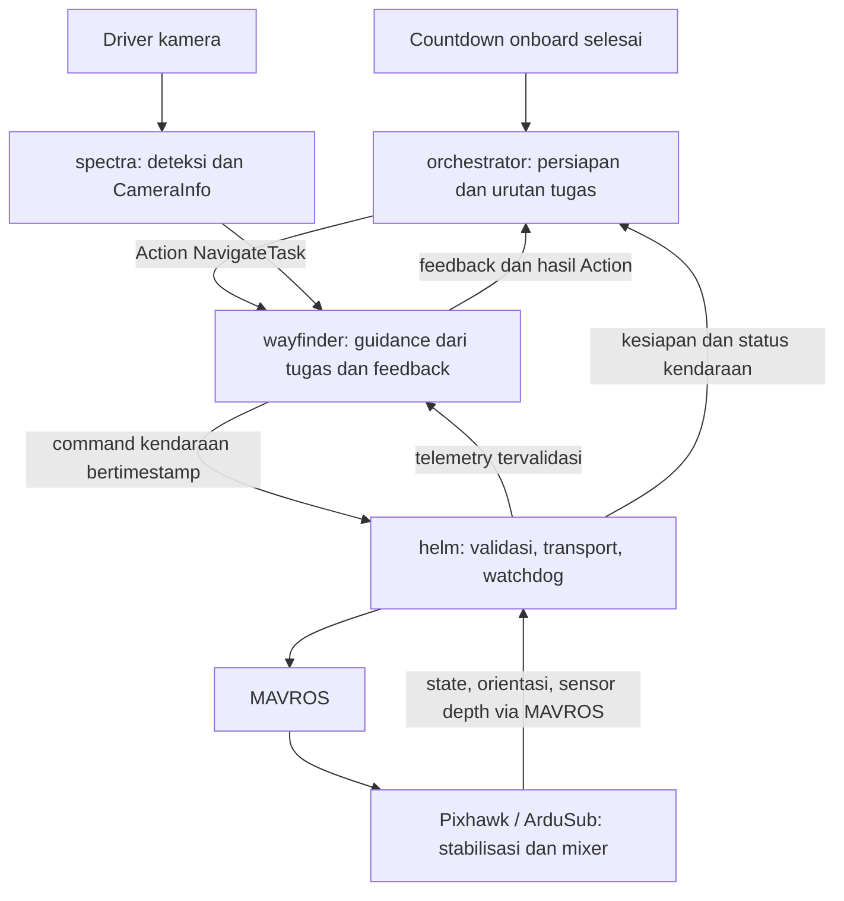

# Proposal implementasi autonomous Aterkia

**Status: disetujui dan sedang diimplementasikan bertahap atas instruksi pengguna.
Progres serta bukti kelulusan dicatat pada [verifikasi](../autonomous-verification.md).**

Tanggal: 22 Oktober 2026. Baseline kode: `b8745ae7059c168562a7a5463bd34a21f4407801`.
Dokumen ini menjadi acuan rancangan; PRD tetap menjadi sumber kebutuhan.
Keputusan pengguna dicatat pada bagian 11. Data hardware yang masih perlu
diverifikasi dicatat terpisah dari keputusan rancangan.

## 1. Tujuan dan hasil yang dituju

AUV menjalankan misi dari komputer onboard: membaca kamera dan sensor,
menghitung gerakan, mengirim perintah ke Pixhawk, memeriksa hasil, kemudian
melanjutkan tugas. Setelah countdown start yang dikonfigurasi selesai dan
pemeriksaan kesiapan berhasil, tidak diperlukan
groundstation, joystick, publisher operator, atau koneksi ke komputer luar
untuk memberi perintah gerak sepanjang misi.

Target akhirnya adalah qualification: **capai kedalaman misi → lewati gate →
putar balik → lewati gate kembali → disarm**.
Qualification hardware baru dinyatakan selesai setelah bukti passage dan
konfirmasi disarm teruji. Alur mock yang sudah ada tetap menjadi regresi.

Tahap awal dibuat cukup kecil untuk diuji end-to-end: program onboard mencapai
kedalaman, berputar berdasarkan IMU, lalu mencari dan mendekati gate berdasarkan
kamera. Ini kemampuan autonomous yang nyata, tetapi belum qualification penuh.

Dasar kebutuhan: [PRD](../../PRD.md), terutama §5, FR-01–FR-10, §8, dan M1–M3.
Dasar pembanding: [riset alur autonomous OpenMantaClaus](../research/openmantaclaus-autonomous-mission-flow.md)
pada commit `f05f646aade941b8c35b3bb166d9c236fb181daf`.

## 2. Kondisi awal dan batas lingkup

| Sudah diketahui | Belum boleh diasumsikan |
| --- | --- |
| Pixhawk dengan ArduSub; delapan thruster Vectored-6DoF; sensor depth tersedia | Versi firmware, konfigurasi output fisik, arah motor, dan parameter failsafe sudah tervalidasi |
| MAVROS, telemetry, dan service arm/disarm sudah tersedia di Aterkia | Depth ROS yang terbaca pasti berasal dari sensor air dan sudah dikalibrasi |
| Misi gate, Action, deteksi, kalibrasi, watchdog, dan recording tersedia pada alur mock | Kamera fisik, housing, driver, kalibrasi, dan detektor sudah siap untuk kolam |
| Telemetry orientasi dapat diberikan Pixhawk | Ada odometri horizontal, GPS underwater, DVL, atau sensor tambahan |
| Endpoint serial bawaan berada di `bench.yaml` | Operator harus mengetik endpoint setiap launch |

Tidak termasuk: teleoperation sebagai fitur utama, mixer delapan motor di ROS,
SLAM/EKF baru, behavior-tree framework, model YOLO baru, payload, dan perluasan
M4. Tidak ditambahkan package runtime baru. Gagasan riset 4–7 yang
sebelumnya ditunda tidak otomatis diaktifkan oleh proposal ini.

## 3. Pembagian kerja dan alur onboard

- `orchestrator` memilih tugas dan mengurus lifecycle; permintaan mode/arm/stop
  selalu melalui `helm`, bukan MAVROS langsung.
- `spectra` mengolah gambar; tidak meneruskan perintah misi seperti pola upstream.
- `wayfinder` menentukan arah, dorongan, dan koreksi kedalaman dari feedback.
- `helm` menjadi satu-satunya pengirim perintah kendaraan; tidak memilih target.
- ArduSub tetap menangani stabilisasi tingkat rendah dan mixer delapan thruster.
- `bootstrap` memuat konfigurasi dan meluncurkan stack lengkap, bukan node bisnis.

Action `/navigation/task` yang sudah ada dipertahankan. Tidak dibuat pengatur
misi atau task framework kedua.

## 4. Antarmuka kendaraan yang ditetapkan

### 4.1 Mode dan transport

**Pilihan pengguna: ArduSub `ALT_HOLD` dengan input sumbu dari program onboard melalui
MAVROS `MANUAL_CONTROL`.** Nama protokol ini tidak berarti ada pengendali manusia.
Pemilihan ini memungkinkan sebagian pengirim dari arsip lama digunakan kembali,
sementara stabilisasi dan depth hold ditangani FCU.

Dokumentasi ArduSub menyebut `ALT_HOLD` memerlukan depth sensor.
Sumber: [Sub Modes](https://ardupilot.org/sub/docs/modes.html).

Penerapan pilihan ini tetap diverifikasi pada versi ArduSub, sensor, dan SITL/bench.
Profil autonomous memerlukan `ALT_HOLD`; konfigurasi mode yang berbeda harus
ditolak. Endpoint, ID pengirim/target, dan batas input disimpan dalam parameter.

### 4.2 Satuan command harus jelas

`/cmd_vel` saat ini memakai m/s dan rad/s. Nilai tersebut **tidak boleh langsung
dianggap sebagai skala input RC**. Dengan belum adanya pengukuran kecepatan
horizontal, kendali ini belum menjamin kecepatan kendaraan tertentu.

Profil hardware memakai `/vehicle/command` dengan message `VehicleCommand`
di `aterkia_interfaces`:

| Bagian | Kontrak |
| --- | --- |
| Header | Timestamp sumber dan `frame_id=base_link` |
| `surge_input` | Input tanpa satuan `[-1,1]`; positif maju |
| `yaw_input` | Input tanpa satuan `[-1,1]`; positif belok kiri/CCW dari atas |
| `heave_input` | Input tanpa satuan `[-1,1]`; positif naik |

Input ini bukan PWM, persentase daya motor terukur, kecepatan linear, atau sudut.
Sway, roll, dan pitch command tidak ditambahkan karena belum dibutuhkan tugas
awal. Kemampuan frame delapan motor tetap digunakan oleh mixer dan stabilisasi FCU.

`wayfinder` memakai parameter input/gain khusus hardware; parameter SI mock
seperti `surge_speed` tidak diberi arti baru. Mock tetap memakai `/cmd_vel`.
Perbedaan output ditangani secara eksplisit dalam package yang sama, tanpa
factory/plugin tambahan. Pada profil hardware, `/cmd_vel` tidak menjadi jalur
aktuator lain yang bersaing dengan `/vehicle/command`.

Command memakai reliable keep-last 1 dan volatile, dengan timestamp yang selalu
maju serta pemeriksaan umur sumber dan waktu penerimaan monotonic. Hanya satu
producer guidance yang aktif. Pemeriksaan jumlah publisher membantu mendeteksi
konflik, bukan pengamanan akses ROS. Konversi input FLU ke konvensi transport
dilakukan sekali di `helm`; orientasi ENU/FLU yang sudah dikonversi MAVROS tidak
dibalik lagi. Kontrak frame baseline ada di [runtime contracts](../interfaces.md).

### 4.3 Kedalaman: loop dengan feedback, bukan menyalin setpoint upstream

`helm` memverifikasi sumber pressure/depth, datum permukaan, satuan, dan timestamp.
`/vehicle/depth_stamped`, message minimal `DepthStamped` berisi Header dan
`depth_m` positif turun, diperlukan untuk guidance. Float64 `/vehicle/depth`
tetap bisa tersedia untuk observasi, tetapi tidak cukup untuk memeriksa umur data.
Orientasi memakai `/vehicle/imu` yang sudah bertimestamp.

`wayfinder` membandingkan kedalaman aktual dengan target misi,
lalu menghasilkan input vertikal terbatas dengan gain proporsional dan deadband.
Di dalam toleransi, input vertikal kembali netral agar FCU mempertahankan depth.
Ini guidance kedalaman di atas kendali FCU, bukan implementasi ulang PID motor
atau stabilisasi sikap. Tanda input harus diuji: target lebih dalam memerlukan
arah turun menurut kontrak FLU.

ArduSub mendokumentasikan input vertikal untuk mengubah gerakan/target depth
pada mode depth hold. Respons aktual, deadzone, batas laju, trim, dan efek
input-hold harus diuji pada firmware yang dipilih sebelum kendali ini diterapkan
ke hardware. Sumber: [Pilot Control](https://ardupilot.org/sub/docs/pilot-control.html).

## 5. Bagaimana misi menghasilkan gerakan

Task `DIVE_TO_DEPTH` dan `APPROACH_GATE` akan ditambahkan pada Action yang sudah
ada. Keduanya belum tersedia pada baseline kode saat ini.

| Tugas/fase | Data untuk memutuskan gerak | Kriteria hasil |
| --- | --- | --- |
| `DIVE_TO_DEPTH` | Error depth terhadap target; orientasi dan health tetap diperiksa | Depth aktual berada dalam toleransi selama beberapa sampel baru pada rentang waktu stabil; bukan hanya menunggu durasi |
| Search | Gambar segar tanpa gate | Yaw pencarian terbatas; tidak maju buta. Deadline hanya mengakhiri dengan gagal |
| Align | Bearing gate dari deteksi dan kalibrasi | Koreksi yaw mengecilkan error; surge ditahan/dibatasi sesuai error |
| `APPROACH_GATE` | Gate segar dan sejajar, depth sesuai, heading tersedia | Maju sampai ambang pendekatan visual yang tervalidasi, lalu netral. Ini hasil pendekatan, bukan bukti gate sudah dilewati |
| `PASS_GATE` | Bukti crossing yang disepakati pada tahap 4 | Berhasil hanya ketika bukti passage valid; tanpa bukti, task hardware tidak tersedia |
| `TURN` | Perubahan heading IMU terhadap heading awal | Error sudut mencapai toleransi dan stabil, bukan putaran dengan timer |

Yaw menggunakan error bearing/heading yang dinormalisasi terhadap batas input.
Dorongan maju dikurangi saat belokan besar, mengambil prinsip upstream tanpa
menyalin gain-nya. Setelah task depth selesai, guidance tetap memeriksa depth
selama tugas berikutnya. Posisi dan drift horizontal tidak diklaim terkendali
hanya karena input maju dan yaw sudah netral.

Kesiapan `wayfinder` dibuat sesuai tugas. Search, approach, depth, dan turn tidak
dipaksa memerlukan odometri horizontal palsu. `PASS_GATE` tetap memerlukan bukti
passage tersendiri. Tidak dibuat Odometry berisi X/Y nol untuk meloloskan readiness.

Urutan pengujian awal:
`DIVE_TO_DEPTH → TURN` untuk loop sensor-kendaraan, lalu
`DIVE_TO_DEPTH → APPROACH_GATE` untuk loop kamera-kendaraan.
Rencana qualification final memakai `PASS_GATE → TURN → PASS_GATE` setelah tahap
persiapan kedalaman dan pembuktian passage tersedia.

## 6. Aktivasi, kesiapan, dan penghentian

### 6.1 Start menggunakan countdown persiapan

Start menggunakan countdown onboard dengan urutan berikut:

1. **AUV dinyalakan di darat.** Komputer onboard dan Pixhawk melakukan startup.
   Program misi mulai berjalan dalam kondisi disarmed.
2. **Countdown persiapan dimulai.** Durasi disimpan dalam parameter, misalnya
   `start_delay_s: 30`. Selama hitungan ini, AUV tetap disarmed dan tidak diberi
   perintah gerak. Operator menyiapkan dan memasukkan AUV ke air.
3. **Countdown selesai.** Program memeriksa koneksi, sensor, konfigurasi, dan
   komponen misi. Jika ada syarat yang gagal, start dibatalkan; tidak arm dan
   tidak menunggu diam-diam untuk mulai sendiri ketika syarat pulih.
4. **Jika siap, program memilih `ALT_HOLD` lalu meminta arming.** Perintah gerak
   baru diizinkan sesudah mode dan armed aktual terkonfirmasi.
5. **AUV menjalankan misi sendiri.** Program mencapai kedalaman target, kemudian
   menjalankan tugas kamera dan navigasi sesuai rencana.
6. **Misi selesai atau gagal: minta disarm**, sesuai pilihan pengguna.

Hitungan dimulai ketika program misi onboard sudah berjalan dan
konfigurasinya berhasil dimuat, bukan tepat ketika daya listrik disambungkan.
Waktu boot OS/container tidak dipotong dari jatah persiapan. Angka 30 detik
merupakan contoh pengguna yang dapat diubah, bukan nilai yang sudah dikalibrasi.
Status countdown dan sisa waktunya harus terlihat pada log/status misi.

Countdown tidak mendeteksi air. Operator harus sudah memasukkan AUV ke air
sebelum hitungan selesai; telemetry depth/IMU yang valid sendiri tidak membuktikan
kendaraan terendam. Bila persiapan belum selesai, startup dibatalkan melalui
abort yang tersedia saat pengujian atau dengan mematikan daya kendaraan.
Tidak diasumsikan ada sensor pendeteksi air atau indikator fisik tambahan.

Timer memakai waktu monotonic dan tidak memblokir callback. Abort membatalkan
countdown maupun persiapan yang sedang berlangsung. Setelah gagal, abort, atau
misi selesai, countdown tidak dimulai ulang otomatis. Pengaturan deployment juga
tidak boleh otomatis mengulang misi setelah proses pengelola misi mati.

### 6.2 Alur program setelah start

Launch menyalakan stack dalam kondisi tidak armed/tidak bergerak. Pada profil
autonomous hardware, program masuk countdown sebelum memulai misi.
Entry point memakai `auv.launch.py` dengan profil hardware dan
konfigurasi tersimpan; endpoint tidak perlu diketik pada penggunaan sehari-hari.
MAVROS, `helm`, `spectra`, `wayfinder`, dan `orchestrator` diluncurkan bersama.
Driver kamera menggunakan driver yang sesuai perangkat setelah perangkat dipilih.

Untuk profil autonomous hardware, habisnya countdown memanggil alur start internal
di `orchestrator` dengan urutan berikut:

1. Periksa koneksi, orientasi/depth segar, konfigurasi kendali, Action server,
   serta kamera/kalibrasi bila tugas membutuhkan penglihatan.
2. Minta mode melalui `helm`; tunggu konfirmasi mode aktual dari state FCU.
3. Minta arm melalui `helm`; tunggu ACK dan konfirmasi armed aktual.
4. Izinkan command untuk sesi misi itu, jalankan task depth, lalu urutan tugas.
5. Lanjut hanya setelah Action mengembalikan hasil berhasil.

Countdown hanya diaktifkan pada profil autonomous hardware. Profil mock dan
telemetry/arming bench tidak tiba-tiba mendapat auto-start. Kontrak
`/mission/start` mock saat ini dipertahankan. Start misi autonomous hardware
hanya melalui countdown; service tidak boleh melewati atau mempercepat timer.

Tahap countdown/persiapan dilaporkan melalui `/mission/status`. Pengaturan agar
program berjalan saat boot merupakan bagian deployment onboard yang perlu
disiapkan; itu belum tersedia hanya karena launch file sudah ada. Groundstation
tidak dibutuhkan untuk menunggu timer atau menjalankan misi.

`helm` harus membedakan kesiapan sebelum arm dan izin command setelah arm,
sehingga tidak terjadi siklus “harus armed agar boleh melakukan preflight”.
Koneksi, freshness, mode aktual, armed aktual, validitas konfigurasi, dan izin
sesi dilaporkan terpisah melalui diagnostic yang sudah dipakai proyek.
Armed dari luar saja tidak memulai misi atau membuka sesi command.

Abort, data invalid/stale, kehilangan command, mode berubah, atau disconnect
mengunci gerakan dan mengakhiri task. Reconnect tidak melanjutkan misi.
Permintaan arm/mode yang selesai terlambat tidak boleh menghidupkan sesi yang
sudah dibatalkan. Setelah terminal, dibutuhkan aktivasi baru yang disengaja.

**Kebijakan saat ini: disarm pada akhir misi atau kegagalan.**
Batalkan tugas dan izin command, netralkan input gerak, lalu segera minta disarm;
disarm tidak menunggu kendaraan naik ke permukaan atau sensor depth pulih.
Keberhasilannya tetap memerlukan konfirmasi state FCU. Bila koneksi putus,
laporkan hasil disarm belum terkonfirmasi, bukan sukses palsu.

Disarm bukan bukti kendaraan sudah berada di permukaan; gerakan pasif sesudahnya
bergantung buoyancy. Perilaku fisik dan aksi failsafe saat companion mati tetap
diverifikasi sebelum uji kolam.

Failsafe pada FCU tetap diperlukan jika proses onboard mati. Aksi yang dituju
adalah disarm; parameter dan perilakunya harus diverifikasi pada firmware yang
digunakan, bukan menyalin nilai arsip.
Dokumentasi mencatat interaksi pilot-input failsafe dengan RC failsafe; ini harus
masuk skenario uji, bukan hanya memeriksa heartbeat.
Sumber: [Pilot Control Failsafe](https://ardupilot.org/sub/docs/pilot-control-failsafe.html).

## 7. Yang diadaptasi dan yang digunakan kembali

| Asal | Bagian yang berguna | Penyesuaian untuk Aterkia |
| --- | --- | --- |
| OpenMantaClaus `brain` | Urutan tugas onboard dan pergantian berdasarkan hasil | Tetap di `orchestrator`, memakai Action, countdown yang dikonfigurasi, dan konfirmasi state |
| Controller upstream | Feedback heading, arah dari penglihatan/target, pengurangan surge saat belok | Masuk `wayfinder`; tidak menyalin prior arena, APF/EKF, atau angka gain tanpa bukti kebutuhan |
| Bridge upstream | Command kendaraan berasal dari program misi | `helm` satu-satunya pemilik transport; tidak perlu kendali manual sebagai fitur utama |
| Arsip `manual_motion.hpp` | Validasi timestamp/frame/nilai, pembatas input, monotonic watchdog, latch stop | Ubah kontrak dan pemilik command menjadi guidance autonomous; periksa ulang mapping dan neutral sesuai mode |
| Arsip `mavros_monitor.cpp` | Permintaan mode async dan konfirmasi state; penjagaan abort ketika arm tertunda | Gunakan konfirmasi `ALT_HOLD` dan kaitkan izin command dengan sesi misi |
| Arsip tes dan peer MAVLink | Pemeriksaan paket, tanda sumbu, replay, timeout, abort, putus koneksi | Tes harus memakai output `wayfinder` dan Action `orchestrator`, bukan hanya publisher pengganti operator |

Arsip sumber: [source-before-rollback.tar.gz](../../artifacts/rollback-manual-control-20261022-184555/source-before-rollback.tar.gz).
Penggunaan kembali dilakukan per bagian sesuai rencana ini; tidak mengembalikan
29 file secara keseluruhan. `ManualCommand`, launch manual, gate parameter
khusus konfigurasi lama, dan seluruh perubahan fixture tidak dipulihkan otomatis.
Angka 67 tes dari eksperimen lama bukan bukti acceptance rancangan autonomous ini.

## 8. Tahapan implementasi

Tahap berikut memperluas milestone PRD, bukan mengganti M0–M4. Setiap tahap harus
dibangun, diuji, dan menghasilkan bukti sebelum melanjutkan tahap dependennya.
Tidak ada estimasi waktu yang menganggap hardware/sensor sudah siap.

### Tahap 0 — Dokumentasikan kontrak dan verifikasi konfigurasi uji (persiapan M1)

- Dokumentasikan kontrak pada bagian 4 dalam dokumentasi interface. Tetapkan
  versi firmware untuk SITL/bench, verifikasi sumber depth, dan tentukan batas
  uji awal. Verifikasi `MANUAL_CONTROL + ALT_HOLD` pada konfigurasi tersebut.
- Bedakan profil mock, telemetry/arming bench, dan autonomous hardware.
- Terapkan kebijakan disarm ke skenario uji; parameter dan perilaku
  failsafe fisik harus tervalidasi sebelum uji propulsi.
- **Bukti selesai:** dokumen kontrak dan matriks skenario yang sudah direview;
  konfigurasi uji dapat direproduksi. Belum ada klaim gerak hardware.

### Tahap 1 — Adapter, telemetry, dan pengaman command (M1)

- Adaptasi pengirim di `helm`, tambahkan command/depth stamped minimal,
  konfirmasi mode, serta watchdog dan pembatalan sesi.
- Pertahankan telemetry dan arming bench sebagai regresi terpisah.
- Uji pembatasan, tanda sumbu, source timestamp, input invalid, publisher ganda,
  mode/ACK/state, abort saat arm tertunda, restart, dan disconnect.
- **Bukti selesai:** build seluruh package; tes ROS dan MAVROS loopback lulus;
  SITL membuktikan input/mode/depth semantics dan perilaku kehilangan command.
  Peer UDP hanya membuktikan paket, bukan dinamika atau failsafe firmware.

### Tahap 2 — Loop autonomous depth dan turn onboard (M1)

- Hubungkan start/preflight/mode/arm/Action di `orchestrator` dengan
  `wayfinder → helm`. Tambahkan `DIVE_TO_DEPTH`; adaptasi `TURN` agar memakai
  telemetry hardware bertimestamp tanpa odometri horizontal.
- Uji countdown yang menghasilkan command dan penyelesaian task tanpa publisher
  operator. Sebelum timer habis tidak boleh ada arm/gerak. Abort saat countdown,
  gagal preflight, serta restart tidak boleh memulai misi tanpa persiapan baru.
  Uji heading wrap ±π dan kedalaman yang tidak pernah tercapai.
- **Bukti selesai:** alur sensor → keputusan → MAVROS → feedback lulus di
  simulator. Proses, task, dan sesi tidak auto-resume setelah kegagalan.

### Tahap 3 — Loop visual search, align, dan approach (M2)

- Gunakan `spectra`, CameraInfo, dan panduan bearing yang sudah tersedia.
  Tambahkan task `APPROACH_GATE` dengan ambang visual yang dinilai pada data uji.
- Uji gate kiri/kanan, sejajar, tidak terlihat, deteksi kosong yang segar,
  kamera hilang, salah kalibrasi, target palsu, dan depth keluar batas.
- **Bukti selesai:** satu misi onboard mengubah arah/maju dari gambar dan
  berhenti menurut kriteria approach; recording menunjukkan seluruh jalurnya.
  Task ini tidak pernah mengaku sebagai keberhasilan `PASS_GATE`.

### Tahap 4 — Pembuktian passage satu gate (M2 menuju M3)

- Putuskan cara memperoleh bukti perpindahan/crossing yang tidak memerlukan
  odometri palsu. Eksperimen pertama memakai kamera terkalibrasi,
  geometri gate terukur, dan rekaman gerak yang dibandingkan referensi independen.
- Eksperimen harus menilai apakah pose/crossing tetap dapat dibuktikan ketika
  gate keluar FOV. Bounding box membesar atau gate menghilang saja tidak cukup.
- Bila kamera dan sensor yang tersedia tidak cukup, hentikan perluasan
  `PASS_GATE`, laporkan kebutuhan terukur, dan review pilihan estimasi atau sensor.
  Tidak otomatis menambahkan SLAM, odometri PWM, VIO, atau DVL.
- **Bukti selesai:** kriteria passage, batas ketidakpastian, data pembanding,
  serta tes gate palsu/hilang/drift disetujui dan lulus. Hingga saat itu,
  `PASS_GATE` hardware ditolak dan M3 hardware belum selesai.

### Tahap 5 — Qualification dan validasi kendaraan (M3)

- Rangkai persiapan kedalaman, pass, putar balik, return pass, dan disarm.
  Heading awal/target diambil dari feedback; return tidak memakai sumbu arena
  yang di-hardcode atau success karena durasi dorongan.
- Jalankan seluruh regresi, SITL, bench propulsi nonaktif, lalu uji kolam
  terkontrol sesudah konfigurasi motor dan perilaku disarm/failsafe lulus pengujian.
- **Bukti selesai:** hasil tugas sesuai referensi nyata; kamera/telemetry hilang,
  abort, dan companion mati menghasilkan perilaku yang sudah disepakati. Log dan
  rekaman tersimpan; ambang kolam ditentukan dari pengukuran, bukan angka upstream.

SITL hanya memodelkan sebagian kondisi. Uji propulsi tiap tahap tidak harus
menunggu seluruh qualification, tetapi hanya boleh dimulai sesudah acceptance
software tahap itu dan commissioning keselamatannya selesai. M4 tetap ditunda.

## 9. Rencana perubahan file

| Lokasi | Perubahan yang direncanakan |
| --- | --- |
| `src/aterkia_interfaces/` | Dua message minimal untuk input kendaraan tanpa satuan dan depth bertimestamp; `NavigateTask` dipertahankan |
| `src/helm/` | Transport terpilih, depth stamped, mode/arm confirmation, freshness, watchdog, stop, diagnostic kesiapan |
| `src/wayfinder/` | Output hardware dengan satuan eksplisit, feedback IMU/depth, task depth/approach, readiness sesuai tugas, passage hanya setelah bukti tersedia |
| `src/orchestrator/` | Persiapan start hardware dan urutan Action; pembatalan persiapan/arm; kebijakan terminal yang disetujui |
| `src/bootstrap/` | Komposisi launch hardware dan konfigurasi autonomous; koneksi memakai konfigurasi bench yang sudah ada agar tidak diduplikasi |
| `src/spectra/` | Pertahankan kontrak; perubahan hanya jika evaluasi kamera/gate menunjukkan kebutuhan nyata |
| `tests/`, konfigurasi recording, dokumentasi | Tes alur lengkap, fault injection, input/output terpilih, dan bukti konfigurasi |

Tidak ada dependency baru yang ditetapkan oleh proposal. Alat SITL/driver yang
dibutuhkan dipilih pada tahap 0; setup pengujian dipisahkan dari dependency runtime.

## 10. Standar verifikasi setiap tahap

- Build seluruh workspace ROS 2 Lyrical, lalu regresi yang relevan dan pemeriksaan
  hasil tes. Tes unit dipakai untuk logika murni; integrasi untuk node/transport;
  SITL untuk perilaku firmware; hardware untuk hasil fisik.
- Verifikasi positif harus menelusuri **misi → data sensor → command guidance →
  command MAVLink → feedback → hasil Action**, bukan hanya penerimaan pesan.
- Tes negatif mencakup timestamp lama/berulang/masa depan, angka invalid,
  kehilangan kamera/IMU/depth, command terlambat, mode berubah, ACK tanpa state,
  respons terlambat, proses mati, dan hilangnya koneksi eksternal saat misi.
  Proses `wayfinder` dan `helm` juga dimatikan secara terpisah ketika MAVROS
  masih hidup, agar heartbeat MAVROS tidak disalahartikan sebagai guidance sehat.
- Command kehilangan freshness dinetralkan dalam batas watchdog ditambah satu
  periode kontrol. Waktu memakai source stamp dan clock monotonic; penghentian
  fisik diuji terpisah. Jika node mati, FCU harus menjalankan failsafe sendiri.
- Nilai awal pengujian software: loop 20 Hz, command timeout 0,5 detik, dan batas
  input 0,2 dari eksperimen lama. Semua harus divalidasi, bukan jaminan
  performa atau persentase daya motor. Deadline sensor disesuaikan laju stream.
- Recording menangkap command stamped, telemetry asli, status/hasil tugas yang
  tersedia, mode/arming, dan konfigurasi. Command terkirim tidak disebut feedback
  thruster. Startup discovery tes dipisahkan dari batas freshness saat berjalan.

## 11. Keputusan pengguna dan verifikasi hardware

Keputusan berikut menjadi acuan implementasi:

1. **Mode/transport:** `MANUAL_CONTROL + ALT_HOLD`, dengan command dari program
   misi onboard.
2. **Kontrak dan lingkup awal:** input surge/yaw/heave tanpa satuan, depth
   bertimestamp, serta task `DIVE_TO_DEPTH` dan `APPROACH_GATE` sebelum pass penuh.
3. **Start:** AUV dinyalakan di darat; program misi memulai countdown persiapan
   dengan durasi yang disimpan dalam parameter, misalnya 30 detik. AUV dimasukkan
   ke air selama countdown. Setelah timer selesai dan pemeriksaan kesiapan
   berhasil, program memilih mode, meminta arming, lalu menjalankan misi.
   Aturan timer dan pembatalannya dijelaskan pada bagian 6.1.
4. **Passage:** eksperimen kamera/geometri terlebih dahulu; `PASS_GATE` hardware
   tetap ditahan sampai bukti keberhasilannya cukup.
5. **Penghentian:** disarm pada akhir misi atau kegagalan, dengan konfirmasi state
   FCU. Kebijakan ini berlaku untuk tahap implementasi saat ini.

Yang masih perlu diverifikasi sebelum uji hardware adalah versi dan parameter
firmware, sumber serta kalibrasi depth, kesiapan kamera, arah motor, batas input,
gain, timeout, dan perilaku failsafe. Bukti crossing gate harus diperoleh melalui
eksperimen tahap 4. Hal-hal ini merupakan pekerjaan verifikasi, bukan pilihan
arsitektur yang dibuka kembali.

Implementasi mengikuti tahapan dan batas lingkup di atas. Kelulusan setiap tahap
dicatat dalam dokumen verifikasi; persetujuan rancangan tidak menggantikan uji
firmware maupun pengujian fisik.
