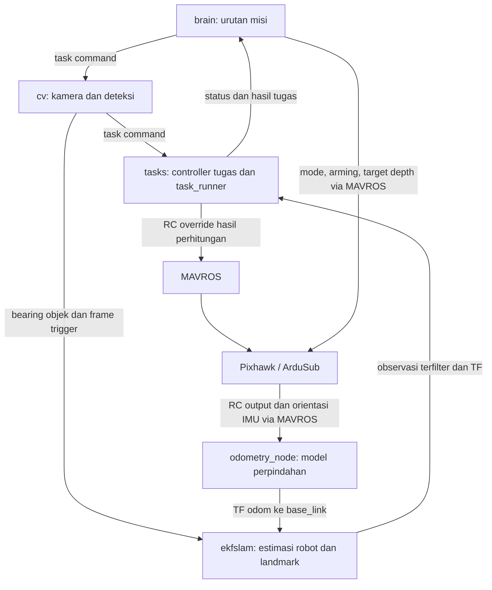

# OpenMantaClaus: misi dan jalur gerak autonomous

Tanggal riset: 22 Oktober 2026. Sumber: branch `main`, commit
[`f05f646aade941b8c35b3bb166d9c236fb181daf`](https://github.com/kushagra77/OpenMantaClaus/commit/f05f646aade941b8c35b3bb166d9c236fb181daf).
Commit ini masih menjadi HEAD upstream ketika diperiksa. Pembanding Aterkia:
`b8745ae7059c168562a7a5463bd34a21f4407801` dan [PRD](../../PRD.md).

Riset ini membaca kode secara statis, termasuk launch, konfigurasi, pengatur misi,
persepsi, estimator, controller tugas, dan pengirim command. Kode upstream tidak
dijalankan; keberhasilan fisik, akurasi estimator, dan respons firmware tidak
diverifikasi. Hasil kompetisi pada README merupakan laporan penulis upstream.
Temuan ini melengkapi [riset sebelumnya](openmantaclaus-review.md), dengan fokus
pada sumber keputusan gerak autonomous. Tidak ada keputusan implementasi baru.

## Temuan utama

**Gerakan dihasilkan program onboard dari tugas, kamera, dan estimasi keadaan.**
`brain` memilih tugas; `cv` menghasilkan observasi; `ekfslam` mengestimasi posisi
robot dan landmark; controller di `tasks` menghitung arah gerak; `task_runner`
mengubah hasilnya menjadi RC override ke MAVROS. Jalur itu dapat ditelusuri dalam
[brain][brain], [CV][cv], [estimator][ekf], dan [task runner][runner].

RC override adalah bentuk perintah pada antarmuka flight controller. Pada jalur
ini, nilainya dihitung program, bukan diterima dari joystick atau publisher
operator. Nama antarmuka RC sendiri tidak menentukan apakah kendaraan bergerak
secara autonomous. Kesimpulan ini berasal dari isi `control_loop()`,
`turnPD()`, dan `rc_override()` di [task runner][runner].

## 1. Jalur data dan perintah



Controller gate terutama membaca posisi melalui TF; isi observasi dipakai untuk
pembaruan estimator dan penanda objek yang pernah terlihat. Jadi jalurnya tidak
sekadar mengubah posisi bounding box langsung menjadi PWM.
Sumber: [controller gate][gate], [controller dasar][task], dan [EKF][ekf].

Launch juga perlu dibedakan. `robot_bringup.launch.py` menjalankan persepsi,
kamera bawah, odometri, EKF, dan task runner. `main.launch.py` atau
`qual.launch.py` menjalankan `brain` dengan konfigurasi misi masing-masing.
Include MAVROS di robot bringup sedang dikomentari; ada launch MAVROS terpisah.
Konfigurasi bridge memiliki `gcs_url` kosong. Groundstation tidak menjadi sumber
perintah gerak dalam jalur misi yang diperiksa.
Sumber: [robot bringup][bringup], [main launch][main], [qualification launch][qual_launch],
[MAVROS-only launch][mavros_only], dan [konfigurasi launch MAVROS][mavros_launch].

## 2. Cara misi mulai dan berganti tugas

Ketika node `brain` dijalankan, timer awal memanggil `run_main_logic()`.
Tidak terlihat service start terpisah pada node ini. Urutannya:

1. Tunggu koneksi FCU; minta mode `MANUAL` dan disarm untuk setup.
2. Kirim target depth, lalu tunggu jeda startup dari konfigurasi.
3. Minta `ALT_HOLD`, kirim ulang target depth, lalu arm.
4. Aktifkan `/ekfslam/activate`, lalu mulai mengambil tugas dari antrean.
5. Kirim tugas ke `/cv/task_command`; CV meneruskan tugas ke `/tasks/task_command`.
6. Setelah menerima hasil tugas, lanjutkan antrean atau jalankan fungsi `surface()`.

Ini perilaku kode upstream, **bukan urutan yang otomatis disetujui untuk Aterkia**.
Respons aktivasi EKF hanya menetapkan flag aktif; bukan pemeriksaan kualitas
estimasi. Pengiriman target depth memakai `GeoPoseStamped` pada
`/mavros/setpoint_position/global`. Pembacaan ini tidak membuktikan target tersebut
diterapkan firmware atau kedalaman aktual tercapai. `brain` tidak berlangganan
feedback depth untuk memeriksa pencapaiannya.
Sumber: [brain, setup dan depth][brain_setup], [inisialisasi EKF][ekf_init].

Antrean main dari YAML adalah:

```text
gate → bucket → gripper → -gate → flare → aruco → -flare → -bucket → -gripper
```

Awalan `-` diubah menjadi `initial=false`. Artinya bergantung pada tugas:
lintasan kembali untuk gate, tahap mengikuti urutan warna untuk flare, atau
pickup untuk gripper. Ini tidak selalu berarti motor diberi dorongan mundur.
Nilai urutan di YAML juga berbeda dari fallback pada header konfigurasi; catatan
ini memakai YAML yang dimuat launch. Sumber: [parameter misi][params],
[dispatch brain][brain_dispatch], dan [pemilihan controller][factory].

## 3. Qualification: maju, putar, kembali

Qualification memakai antrean `qual_gate`, lalu `-qual_gate`. Controller
`QualGate` sendiri memiliki tiga state: `FORWARD`, `TURN`, dan `BACKWARD`.

| Tahap | Dasar keputusan pada kode |
| --- | --- |
| `FORWARD` | Gunakan estimasi posisi robot dan dua sisi gate untuk menghitung arah. Pindah ke `TURN` setelah X robot melampaui X gate ditambah exit margin. |
| `TURN` | Simpan target heading relatif terhadap heading saat transisi. Belok sampai selisih heading berada dalam toleransi. |
| `BACKWARD` | Arahkan kendaraan kembali melewati gate. Selesai setelah X robot berada di sisi sebaliknya melewati return margin. |

YAML menetapkan margin maju 1,5 m, margin kembali 5 m, offset putaran −179°,
dan toleransi sudut 1,5°. Nilai ini milik kendaraan/arena upstream, bukan hasil
kalibrasi Aterkia. Pemeriksaan passage memakai sumbu X peta mereka.
Sumber: [qual_gate.cpp][qual], [enum state][factory_header], dan [YAML][params].

Ada koordinasi khusus saat mulai berputar. Status `qual_gate` dengan state `1`
(`TURN`) membuat `brain` mengirim antrean berikutnya, `-qual_gate`. CV kemudian
menukar identitas sisi gate untuk pandangan kembali, **tanpa membuat ulang
controller tugas yang sedang berjalan**. Controller itu melanjutkan state-nya
sampai return selesai. Sumber: [status callback brain][brain_dispatch],
[handoff CV][cv_handoff], dan [filter gate][filter_gate].

Sesudah putaran, kendaraan diarahkan maju menurut heading barunya ke arah X peta
yang berkurang. Nama `BACKWARD` di state ini tidak cukup untuk menyimpulkan
bahwa mereka memakai reverse thrust. Lihat [QualGate][qual] dan
[pemilihan dorongan pada control loop][runner].

## 4. Dari arah target menjadi perintah gerak

Controller menggunakan posisi robot, target, dan penghalang pada peta untuk
membentuk arah gerak. Fungsi potential field memberi kecenderungan menuju target
serta mengitari objek tertentu. `clean_command()` mengubah vektor arah menjadi
selisih heading terhadap orientasi robot. Sumber: [gate][gate] dan
[fungsi arah/potential field][task].

Task runner memperbarui kontrol pada 20 Hz sesuai YAML. Error heading masuk
controller PD, lalu output yaw dibatasi. Untuk tugas navigasi biasa, dorongan
maju dikurangi menjadi setengah saat error arah melebihi 45°, dan nol saat
melebihi 90°. Ada cabang khusus untuk putar di tempat.
Sumber: [control loop dan PD][runner], [parameter kontrol][params].

`rc_override()` menerapkan skala maju bawaan `0.3` dan menulis input yang
dimaksudkan kode sebagai yaw ke `channels[3]`, maju ke `channels[4]`, lalu
menerbitkan `/mavros/rc/override`. Array tersebut berindeks nol. Kanal input
kendaraan tidak sama dengan nomor delapan motor Aterkia. Kode memakai pusat
1500 dan skala 500 untuk membentuk nilai RC; ini bukan keluaran kecepatan m/s.
Sumber: [pengirim RC][runner_rc] dan [konstanta protokol][protocol].

Dengan demikian, yang membuatnya autonomous adalah asal keputusan: controller
misi menghitung perintah dari keadaan robot dan target, kemudian mengulanginya
dengan feedback. Menerbitkan RC dari terminal bukan alur misi yang ditelusuri ini.

## 5. Apa yang diberikan kamera dan sensor?

| Sumber | Pemakaian yang ditemukan |
| --- | --- |
| Kamera depan | Deteksi objek, penyaringan berdasarkan tugas, dan bearing target dari intrinsics kamera. |
| Orientasi IMU melalui MAVROS | Heading odometri; offset heading awal ditetapkan saat model pertama kali melihat RC tidak netral. |
| `/mavros/rc/out` | Input model dorongan untuk memperkirakan kecepatan dan perpindahan horizontal; bukan pengukuran perpindahan langsung. |
| Target depth melalui MAVROS | `brain` meminta target dan mode `ALT_HOLD`; niatnya menyerahkan kontrol kedalaman ke ArduSub. Pencapaian depth tidak diperiksa node brain. |
| Kamera bawah/OpenMV | Mengirim sudut target khusus gripper melalui bridge UDP dan topik ROS. Ini kebutuhan hardware tambahan pada jalur payload. |

Sumber: [CV][cv], [konversi bearing][bearing], [odometry node][odom_node],
[model gerak][odom_model], [setup brain][brain_setup], dan [kamera bawah][bottom].

Model odometri menggunakan massa, drag, koefisien dorongan, dan output RC khusus
kendaraan mereka. Ada pembalikan tanda ESC dan pembatasan kecepatan linear agar
tidak negatif. README sendiri memperingatkan bahwa node ini perlu diganti atau
disesuaikan untuk kendaraan lain. OpenMantaClaus memakai lima thruster; Aterkia
memakai delapan dengan konfigurasi berbeda. Modelnya tidak dapat langsung
dianggap benar untuk Aterkia. Sumber: [model odometri][odom_model] dan
[penjelasan hardware/odometri upstream][readme].

EKF menggabungkan perubahan pose dari `odom → base_link` dengan bearing visual.
Kamera sendiri memberikan sudut, bukan pembacaan jarak absolut. Estimator juga
diinisialisasi dengan prior posisi gate, flag, flare, bucket, serta constraint
lebar gate dan jarak antarbucket. Jadi estimasinya bergantung pada model gerak
dan pengetahuan arena, bukan hanya kamera dan IMU tanpa asumsi geometri.
Sumber: [inisialisasi landmark][ekf_init], [prediksi dan pembaruan bearing][ekf],
serta [konfigurasi prior][params].

TF landmark diterbitkan sejak prior tersedia, termasuk landmark yang belum
terlihat. Controller juga dapat menghitung gerak dari peta itu ketika tidak ada
observasi baru. Inferensi dari kode: gerakan awal dapat mengarah ke perkiraan
posisi gate sebelum gate benar-benar terdeteksi. Ini berbeda dari keharusan
selalu mencari gate secara visual terlebih dahulu.
Sumber: [publikasi TF EKF][ekf_tf], [gate gain saat belum terlihat][gate],
dan [eksekusi tanpa observasi baru][runner].

## 6. Tugas final yang ada di kode

| Tugas | Perilaku controller dan dasar selesai |
| --- | --- |
| Gate arena | Arah potential field melalui gate; selesai berdasarkan posisi X terhadap gate dan exit margin. |
| Bucket | Mendekati posisi bucket pada peta; memakai klasifikasi warna yang dikunci untuk memilih target; selesai berdasarkan jarak. |
| Gripper | Alignment dari kamera bawah, lalu task runner memberi perintah kanal dan gerakan dengan jeda untuk drop/pickup. Timeout juga dapat menghasilkan status selesai. |
| Flare | Mengunjungi tiga flare untuk scanning; tahap berikutnya memilih urutan berdasarkan informasi warna/urutan yang disimpan. Ada cabang yang menganggap flare di luar batas sebagai telah dilewati. |
| ArUco | Mendekati posisi marker sambil menghindari flag; selesai jika urutan sudah diperoleh atau jarak sudah memenuhi threshold. |

Sumber: [gate][gate], [bucket][bucket], [gripper][gripper], [task runner][runner],
[flare][flare], [ArUco][aruco], dan [penyimpanan warna/urutan][task].
Keberadaan controller tidak membuktikan seluruh tugas berhasil secara fisik.

## 7. Bagian yang tidak boleh dianggap sudah aman atau portabel

- `brain` berhenti berlangganan state setelah koneksi pertama terdeteksi.
  Jalur ini bukan contoh pemantauan koneksi terus-menerus yang cukup untuk
  Aterkia. Sumber: [state callback][brain_dispatch].
- Saat observasi baru tidak datang, control loop tetap memanggil executor memakai
  pesan kosong; lookup TF memakai transform terakhir tanpa pemeriksaan umur di
  helper. Ketiadaan kamera tidak otomatis berarti gerak dinetralkan.
  Sumber: [runner][runner], [lookup TF][task].
- `surface()` meminta depth nol, kemudian disarm dan ganti mode tanpa menunggu
  feedback kedalaman. Nama fungsi/log bukan bukti kendaraan sudah naik ke permukaan.
  Sumber: [fungsi surface][brain_dispatch].
- Timeout gripper dapat diperlakukan sebagai selesai; ini tidak memenuhi FR-09
  Aterkia bila tanpa bukti sukses aktuator. Sumber: [gripper][gripper].
- Beberapa lookup TF controller tidak terlindungi guard awal. Konfigurasi arena,
  channel, gain, delay, dan urutan auto-arm bukan parameter siap pakai untuk robot
  lain. Sumber: [gate][gate], [qualification][qual], dan [setup][brain_setup].

Ada utility lain, `mavros_control/controller.py`, yang menjalankan gerak maju
berdasarkan durasi dan belokan berdasarkan IMU. Utility itu bukan jalur misi
berbasis kamera `brain → cv → ekfslam → tasks`. Riset implementasi autonomous
tidak boleh berhenti pada utility tersebut. Sumber: [utility controller][utility]
dan [launch robot][bringup].

## 8. Implikasi untuk Aterkia — bahan pembahasan, belum implementasi

Alur yang sesuai PRD tetap `orchestrator → wayfinder → helm → MAVROS → Pixhawk`,
dengan `spectra` dan telemetry memberi feedback ke guidance. Temuan upstream
memperlihatkan cara program onboard menjadi sumber perintah kendaraan tanpa
perintah gerak terus-menerus dari operator. Pembagian tugas upstream tidak perlu
disalin; khususnya, forwarding misi melalui persepsi bukan kebutuhan Aterkia.

Pada baseline Aterkia yang diperiksa, alur misi sudah menggerakkan kendaraan mock,
tetapi launch hardware ditolak dan monitor MAVROS menolak `/cmd_vel`.
`wayfinder` juga mensyaratkan odometri untuk readiness dan bukti passage.
Sumber lokal: [launch AUV](../../src/bootstrap/launch/auv.launch.py),
[wayfinder](../../src/wayfinder/src/node.cpp), dan
[monitor MAVROS](../../src/helm/src/mavros_monitor.cpp).

Tiga keputusan yang perlu dibahas sebelum implementasi berikutnya:

1. **Kontrak gerak autonomous:** perintah dari guidance onboard yang dapat
   dilaksanakan ArduSub, dengan satuan, mode, dan feedback yang jelas. Jangan
   langsung menganggap skala RC upstream setara dengan `/cmd_vel` SI Aterkia.
2. **Feedback dan bukti tugas:** cara memakai orientasi, depth yang terverifikasi,
   dan kamera, serta cara membuktikan gate terlewati tanpa membuat odometri
   palsu. Model PWM upstream adalah salah satu pendekatan mereka, bukan bukti
   bahwa pendekatan itu diperlukan atau cukup untuk Aterkia.
3. **Mulai, selesai, dan gagal:** aktivasi misi yang sah, pemeriksaan kesiapan,
   arming, abort, timeout, command loss, dan disconnect yang mengikuti PRD.
   Peluncuran program tidak otomatis menjadi izin arming seperti pola upstream.

Catatan ini tidak memilih API akhir, mengaktifkan arming otomatis, menambahkan
SLAM, atau mengizinkan gagasan riset lain yang sebelumnya ditunda. Tidak ada kode
runtime, konfigurasi kendaraan, atau PRD yang diubah oleh riset ini.

[readme]: https://github.com/kushagra77/OpenMantaClaus/blob/f05f646aade941b8c35b3bb166d9c236fb181daf/README.md
[brain]: https://github.com/kushagra77/OpenMantaClaus/blob/f05f646aade941b8c35b3bb166d9c236fb181daf/src/brain/src/brain.cpp
[brain_setup]: https://github.com/kushagra77/OpenMantaClaus/blob/f05f646aade941b8c35b3bb166d9c236fb181daf/src/brain/src/brain.cpp#L193-L307
[brain_dispatch]: https://github.com/kushagra77/OpenMantaClaus/blob/f05f646aade941b8c35b3bb166d9c236fb181daf/src/brain/src/brain.cpp#L105-L177
[cv]: https://github.com/kushagra77/OpenMantaClaus/blob/f05f646aade941b8c35b3bb166d9c236fb181daf/src/cv/cv/cv_node.py
[cv_handoff]: https://github.com/kushagra77/OpenMantaClaus/blob/f05f646aade941b8c35b3bb166d9c236fb181daf/src/cv/cv/cv_node.py#L338-L369
[bearing]: https://github.com/kushagra77/OpenMantaClaus/blob/f05f646aade941b8c35b3bb166d9c236fb181daf/src/cv/cv/utils/filter_detections.py#L106-L117
[filter_gate]: https://github.com/kushagra77/OpenMantaClaus/blob/f05f646aade941b8c35b3bb166d9c236fb181daf/src/cv/cv/utils/filter_detections.py#L209-L269
[runner]: https://github.com/kushagra77/OpenMantaClaus/blob/f05f646aade941b8c35b3bb166d9c236fb181daf/src/tasks/src/task_runner.cpp
[runner_rc]: https://github.com/kushagra77/OpenMantaClaus/blob/f05f646aade941b8c35b3bb166d9c236fb181daf/src/tasks/src/task_runner.cpp#L180-L222
[protocol]: https://github.com/kushagra77/OpenMantaClaus/blob/f05f646aade941b8c35b3bb166d9c236fb181daf/src/tasks/include/tasks/task_protocol.hpp
[task]: https://github.com/kushagra77/OpenMantaClaus/blob/f05f646aade941b8c35b3bb166d9c236fb181daf/src/tasks/src/controllers/task.cpp
[qual]: https://github.com/kushagra77/OpenMantaClaus/blob/f05f646aade941b8c35b3bb166d9c236fb181daf/src/tasks/src/controllers/qual_gate.cpp
[gate]: https://github.com/kushagra77/OpenMantaClaus/blob/f05f646aade941b8c35b3bb166d9c236fb181daf/src/tasks/src/controllers/gate.cpp
[bucket]: https://github.com/kushagra77/OpenMantaClaus/blob/f05f646aade941b8c35b3bb166d9c236fb181daf/src/tasks/src/controllers/buckets.cpp
[flare]: https://github.com/kushagra77/OpenMantaClaus/blob/f05f646aade941b8c35b3bb166d9c236fb181daf/src/tasks/src/controllers/flare.cpp
[aruco]: https://github.com/kushagra77/OpenMantaClaus/blob/f05f646aade941b8c35b3bb166d9c236fb181daf/src/tasks/src/controllers/aruco.cpp
[gripper]: https://github.com/kushagra77/OpenMantaClaus/blob/f05f646aade941b8c35b3bb166d9c236fb181daf/src/tasks/src/controllers/gripper.cpp
[factory]: https://github.com/kushagra77/OpenMantaClaus/blob/f05f646aade941b8c35b3bb166d9c236fb181daf/src/tasks/src/controllers/task_factory.cpp
[factory_header]: https://github.com/kushagra77/OpenMantaClaus/blob/f05f646aade941b8c35b3bb166d9c236fb181daf/src/tasks/include/tasks/controllers/task_factory.hpp
[params]: https://github.com/kushagra77/OpenMantaClaus/blob/f05f646aade941b8c35b3bb166d9c236fb181daf/src/manta_bringup/launch/params.yaml
[ekf]: https://github.com/kushagra77/OpenMantaClaus/blob/f05f646aade941b8c35b3bb166d9c236fb181daf/src/ekfslam/src/ekfslam.cpp
[ekf_init]: https://github.com/kushagra77/OpenMantaClaus/blob/f05f646aade941b8c35b3bb166d9c236fb181daf/src/ekfslam/src/ekfslam.cpp#L41-L124
[ekf_tf]: https://github.com/kushagra77/OpenMantaClaus/blob/f05f646aade941b8c35b3bb166d9c236fb181daf/src/ekfslam/src/ekfslam.cpp#L636-L676
[odom_node]: https://github.com/kushagra77/OpenMantaClaus/blob/f05f646aade941b8c35b3bb166d9c236fb181daf/src/ekfslam/src/odometry_node.cpp
[odom_model]: https://github.com/kushagra77/OpenMantaClaus/blob/f05f646aade941b8c35b3bb166d9c236fb181daf/src/ekfslam/src/utils/odometry.cpp
[bottom]: https://github.com/kushagra77/OpenMantaClaus/blob/f05f646aade941b8c35b3bb166d9c236fb181daf/src/cv/cv/bottom_cv_node.py
[bringup]: https://github.com/kushagra77/OpenMantaClaus/blob/f05f646aade941b8c35b3bb166d9c236fb181daf/src/manta_bringup/launch/robot_bringup.launch.py
[main]: https://github.com/kushagra77/OpenMantaClaus/blob/f05f646aade941b8c35b3bb166d9c236fb181daf/src/manta_bringup/launch/main.launch.py
[qual_launch]: https://github.com/kushagra77/OpenMantaClaus/blob/f05f646aade941b8c35b3bb166d9c236fb181daf/src/manta_bringup/launch/qual.launch.py
[mavros_only]: https://github.com/kushagra77/OpenMantaClaus/blob/f05f646aade941b8c35b3bb166d9c236fb181daf/src/manta_bringup/launch/only_mavros.launch.py
[mavros_launch]: https://github.com/kushagra77/OpenMantaClaus/blob/f05f646aade941b8c35b3bb166d9c236fb181daf/src/manta_bringup/launch/mavros.launch
[utility]: https://github.com/kushagra77/OpenMantaClaus/blob/f05f646aade941b8c35b3bb166d9c236fb181daf/src/mavros_control/mavros_control/controller.py#L203-L286
